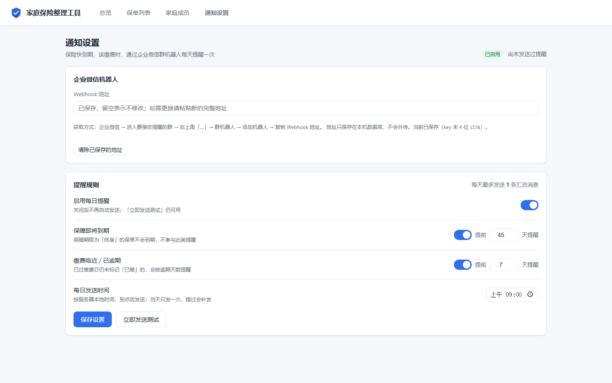

# 家庭保险整理工具

一个**本地优先、可一条命令容器化**的家庭保单整理与统计工具。用于集中登记家庭成员与保单，
自动计算年化保费、缴费进度、近 60 天待缴清单，并以看板 / 饼图 / 柱状图直观呈现。

- **技术栈**：Python 3.13 / FastAPI + SQLAlchemy 2.x + Pydantic v2 + SQLite；
  前端为**原生 HTML + ES Module + 原生 CSS（无构建步骤、零外部依赖）**，由 FastAPI 同源托管。
- **数据存储**：单文件 SQLite（默认 `./data/insurance.db`），金额以整数「分」存储，杜绝浮点误差。

---

## 一、功能概览

> 以下截图均使用**虚构演示数据**（张伟一家 4 人 / 7 张保单），与任何真实保单无关。

**总览看板** — 6 个统计口径、成员与险种分布、待缴清单、逾期补缴入口


**保单列表** — 筛选、搜索、缴费进度、行内操作、底部汇总


**家庭成员** — 按关系排序、年化保费、已有保障类型、统计状态


**通知设置** — 企业微信机器人，保险快到期 / 该缴费时每天提醒一次



### 能力清单

| 模块 | 能力 |
|---|---|
| 总览看板 | 年度总保费、近 60 天待缴（金额 / 笔数）、保单总数、在保人数；成员保费分布（饼图，可切换被保人 / 投保人）、险种保费分布（柱状图）、近 60 天待缴清单（含合计） |
| 保单列表 | 完整字段表格、缴费进度条、被保人 / 险种 / 状态 / 缴费方式筛选 + 关键词搜索、底部汇总、行内编辑 / 删除 |
| 家庭成员 | 成员增删改查、按关系排序、删除被引用成员时给出明确提示 |
| 售后信息 | 每张保单可记录服务顾问（姓名 / 电话 / 微信 / 邮箱）、保险公司联系电话、投保渠道（名称 / 电话）；填写时有「常用值」历史提示 |
| 批量编辑 | 列表多选后一次性更新售后信息，**只覆盖显式填写的字段**（留空 = 不改，另可显式「设为空」） |
| 电子保单 PDF | 上传 / 在线查看 / 下载 / 删除 PDF 附件，随保单归档；单文件 ≤20MB、每张保单 ≤10 个 |
| 消息提醒 | **企业微信机器人**每日推送一条汇总消息：保障即将到期（可设提前天数）+ 缴费临近 / 已逾期；可自定义发送时间，当天只发一次 |
| 计算口径 | 年化保费、总缴费期数、已缴期数、累计已缴、剩余期数、是否缴清、缴费进度、是否在保、下次缴费日 |

---

## 二、本地运行（推荐用于日常使用）

### 环境要求
- Python **3.12+**（本项目在 3.13 上开发与验证）。

### 一键启动

- **Windows**：双击 `start.bat`
- **macOS / Linux**：

  ```bash
  ./start.sh
  ```

脚本会自动完成「创建虚拟环境 → 安装依赖 → 启动服务」。启动后浏览器访问：

```
http://127.0.0.1:8000
```

### 手动启动（分步）

```bash
# 1. 创建并激活虚拟环境
python -m venv .venv
# Windows
.venv\Scripts\activate
# macOS / Linux
source .venv/bin/activate

# 2. 安装依赖
pip install -r requirements.txt

# 3. 启动服务（默认端口 8000，可用 PORT 覆盖）
uvicorn app.main:app --host 127.0.0.1 --port 8000
```

### 环境变量

| 变量 | 默认值 | 说明 |
|---|---|---|
| `DB_PATH` | `./data/insurance.db` | SQLite 数据库文件路径（首次启动自动建表） |
| `PORT` | `8000` | 监听端口 |
| `STATIC_DIR` | `static` | 前端静态资源目录 |
| `ATTACHMENTS_DIR` | `./data/attachments` | 电子保单 PDF 落盘目录（默认与数据库同源在 `./data/` 下） |
| `MAX_ATTACHMENT_SIZE` | `20971520`（20MB） | 单个附件大小上限（字节） |
| `MAX_ATTACHMENTS_PER_POLICY` | `10` | 单张保单附件数量上限 |
| `NOTIFICATION_SCHEDULER` | `true` | 是否启用「每日提醒」后台任务（关掉后仍可手动发测试） |

> 例：临时用独立数据库与端口启动：`DB_PATH=./data/demo.db PORT=8123 uvicorn app.main:app`（Windows PowerShell 用 `$env:DB_PATH=...; $env:PORT=...`）。

---

## 三、到期提醒（企业微信机器人）

保险快到期、该缴费的时候，让它自己来找你——每天一条汇总消息推到微信。

### 1. 先拿到 Webhook 地址

企业微信 → 进入要接收提醒的群（建议单独拉一个只有自己的群）→ 右上角「…」→ 群机器人 → 添加机器人 → 起个名字 → **复制 Webhook 地址**（形如 `https://qyapi.weixin.qq.com/cgi-bin/webhook/send?key=xxxx`）。

### 2. 在工具里填上

打开「**通知设置**」→ 粘贴 Webhook → 打开「启用每日提醒」→ 设定两类提醒的提前天数与发送时间 → 保存。

- **保障即将到期**：距离保障结束还有 N 天时提醒；「终身」保单不会到期，不参与此类提醒。
- **缴费临近 / 已逾期**：下次缴费日在 N 天内、或已过缴费日却还没标记「已缴」时提醒（逾期超过 60 天不再重复提醒，避免变成噪音）。
- **每天最多一条汇总消息**，不逐单轰炸；当天只发一次，服务重启也不会重发。
- 点「**立即发送测试**」可马上验证配置是否生效（会先保存当前表单，再发一条）。

### 3. 它是怎么"到点"的

应用启动时起一个常驻后台任务，每分钟判断一次「是否已到发送时间 + 今天是否已发过」。网络或配置异常只记日志，**不影响应用正常使用**。

> 只有当天确实存在待提醒项时才会发消息：既没有临近到期、也没有待缴时不会发空消息。
> 时间口径用**服务器本地时间**（容器内默认 `Asia/Shanghai`）。

### 安全与隐私

Webhook 里的 key 就是发消息的凭证，因此做了三层保护：

- 数据库里存完整地址，但**接口只回传 `key=****末4位`**，页面上永远看不到完整 key（把脱敏值原样提交会被后端拒绝，避免覆盖真实 key）；
- 后端只接受 `https://qyapi.weixin.qq.com/cgi-bin/webhook/send?key=...` 这一种地址，防止被配成任意 URL 去访问内网；
- 提醒消息只含产品名、公司、被保人姓名、金额与日期，**不含证件号、手机号等敏感信息**。

---

## 四、Docker 部署

### 极空间 NAS 部署

如果你要部署到**极空间 NAS**（或其他支持 Docker 的 NAS），请看专门的新手图文指南：**[docs/DEPLOY-ZSPACE.md](docs/DEPLOY-ZSPACE.md)**。

**镜像已经打包好并发布到本仓库的 Release**（无需安装 Docker）：

- 下载：**[v1.8.0 Release](https://github.com/M1aaa/family-insurance-manager/releases/tag/v1.8.0)**
  → 附件 `family-insurance-manager-1.8.0-amd64.tar`（150.3 MB，linux/amd64）
- 本地构建产物：`dist/family-insurance-manager-1.8.0-amd64.tar`（157,562,880 字节）
- sha256: `371e74e2a88d978c3a5236f7650262a878e087cab206ec3dee52e60f0f40e025`
- 镜像: `family-insurance-manager:1.8.0`

> 想回滚到 v1.7：[v1.7.0 Release](https://github.com/M1aaa/family-insurance-manager/releases/tag/v1.7.0)（`ffdf954b…`）。

> 仓库本身不存放大文件（GitHub 单文件上限 100 MB），**镜像统一发布到 Releases**。
> 每个版本的 tar 作为对应 tag 的附件上传，下载后核对 sha256 再导入。

把它上传到极空间 → `Docker → 镜像 → 本地镜像 → 导入镜像 → 从极空间导入` → 再 `Docker → Compose → 新增项目`（粘贴 `docker-compose.yml`，**记得把 volumes 里的 `/REPLACE_ME/data` 换成用「查询路径」拿到的真实路径**）即可。

> 该 tar 是在**没有任何容器工具**的电脑上，按 `docker save` 经典格式用纯 Python 脚本组装出来的
> （见 `tools/offline-image-build/`）。已通过 **106 项**静态校验（含 history 与层数关系、
> 每层 `VERSION`+`json`+`layer.tar` 三件套）。v1.2 的镜像**已在极空间上实跑成功**，v1.3 沿用同源结构。
> 报错排查见 `docs/DEPLOY-ZSPACE.md` 5.1 节。

### 自己构建（需要 Docker）

```bash
# Windows: scripts\build-image.bat    macOS/Linux:
chmod +x scripts/build-image.sh   # 首次运行前赋予可执行权限（仅需一次；macOS/Linux）
./scripts/build-image.sh
```

它会自动「构建镜像 → 导出 `dist/family-insurance-manager-1.2.0.tar`」，然后把该 tar 上传到极空间导入即可（详见指南）。

### 一条命令启动（本机 / 已装 Docker 的机器）

```bash
docker compose -f docker-compose.build.yml up -d --build
```

启动后访问 <http://localhost:8000>。

> 说明：`docker-compose.yml` 是**极空间运行用**（只有 `image:`，无 `build:`）；
> `docker-compose.build.yml` 是**本机构建/试跑用**（含 `build:`）。二者分工不同，勿混用。

### 数据持久化

`docker-compose.yml` 将宿主机 `./data` 目录挂载到容器 `/app/data`，其中保存 SQLite 数据文件
（`./data/insurance.db`）与电子保单 PDF（`./data/attachments/`），**重启 / 重建容器数据不丢**。
两者同在 `./data` 下，因此**只需一个卷**即可同时持久化数据库与附件。

### 常用命令

```bash
docker compose logs -f          # 查看日志
docker compose ps               # 查看容器与健康状态（healthy）
docker compose down             # 停止并移除容器（数据仍保留在 ./data）
```

> 镜像内置 `HEALTHCHECK`，使用 Python 标准库探测 `GET /api/health`（镜像内不含 curl）。

---

## 五、API 概览

所有接口位于 `/api` 前缀下，成功直接返回资源对象，错误统一返回
`{ "code": "...", "message": "...", "detail": ... }`。

| 方法 | 路径 | 说明 |
|---|---|---|
| GET | `/api/health` | 健康检查（含数据库连通性） |
| GET | `/api/meta/enums` | 前端下拉框枚举字典（一次取全 7 组） |
| GET/POST | `/api/members` | 成员列表 / 新增 |
| PUT/DELETE | `/api/members/{id}` | 成员编辑 / 删除（被保单引用返回 409） |
| GET/POST | `/api/policies` | 保单列表（支持筛选 / 搜索）/ 新增 |
| GET/PUT/DELETE | `/api/policies/{id}` | 保单详情 / 编辑 / 删除（删除返回 `deletedAttachments`） |
| POST | `/api/policies/{id}/pay-next` | 登记下一期缴费（把最早未缴期次标记为已缴） |
| POST | `/api/policies/batch-update` | 批量编辑售后字段（只覆盖显式填写的字段） |
| GET | `/api/policies/suggestions` | 售后字段「常用值」聚合（可选 `limit`，默认 20） |
| POST/GET | `/api/policies/{id}/attachments` | 附件上传（multipart `files`）/ 列表 |
| DELETE | `/api/policies/{id}/attachments/{attId}` | 删除单个附件 |
| GET | `/api/policies/{id}/attachments/{attId}/content` | 附件查看 / 下载（`?disposition=inline\|attachment`，默认 `inline`） |
| GET | `/api/stats/dashboard` | 看板聚合数据（可选 `today=YYYY-MM-DD`） |
| GET/PUT | `/api/stats/exclusions` | 读取 / 全量替换「不计入统计」排除配置 |
| GET/PUT | `/api/notifications/settings` | 读取 / 部分更新通知配置（Webhook 回显已脱敏） |
| POST | `/api/notifications/test` | 立即发送一条测试消息（不受开关 / 时间限制） |

交互式接口文档：启动后访问 `/docs`（Swagger UI）。

---

## 六、项目结构

```
保险整理工具/
├── app/                # FastAPI 后端（routers / services / models / calc 分层）
├── static/             # 无构建前端（index.html + css + js）
│   ├── js/views/       # dashboard / policies / members / settings 四视图
│   ├── js/components/  # modal / policyForm / memberForm / batchEditModal …
│   └── js/             # main(路由) / api / store / format / chart
├── tests/              # 后端测试（pytest）
├── data/               # 运行期数据目录（数据库 + 附件，运行时生成）
│   ├── insurance.db    # SQLite 数据库
│   └── attachments/    # 电子保单 PDF
├── docs/               # PRD、架构文档与部署指南
│   └── DEVELOPMENT-HISTORY.md   # 开发全过程记录（v1.0→v1.8，为什么这么改都在这）
├── scripts/            # 一键构建镜像并导出 tar（build-image.sh / .bat）
├── tools/offline-image-build/  # 无 Docker 组装镜像的脚本（step1~step5）
├── dist/               # 镜像 tar 产物
│   └── family-insurance-manager-1.8.0-amd64.tar   # 已预构建好，可直接导入
├── requirements.txt    # 运行依赖（== 锁定）
├── Dockerfile          # 单阶段镜像
├── docker-compose.yml        # 极空间运行用（只有 image:）
├── docker-compose.build.yml  # 本机构建 / 试跑用（含 build:）
└── README.md
```

---

## 七、开发与测试

```bash
# 安装开发依赖
pip install -r requirements-dev.txt

# 运行后端测试
pytest -q
```

前端为原生静态资源，修改 `static/` 下的文件后刷新浏览器即可，无需任何构建步骤。

---

## 八、常见问题

- **端口被占用**：设置 `PORT` 环境变量改用其他端口，或修改 `docker-compose.yml` 的端口映射。
- **想重置数据**：停止服务后删除 `data/insurance.db`（数据库）与 `data/attachments/`（PDF 附件），下次启动会重新建表。
- **数据在哪**：都在 `./data/` 下——数据库 `./data/insurance.db`、PDF 附件 `./data/attachments/`（本地或 Docker 宿主机同路径）。
- **收不到企业微信提醒**：先点「立即发送测试」——
  - 提示 `Webhook 地址无效或机器人已被移除` → 回群里重新复制地址；
  - 提示发送成功但群里没消息 → 检查机器人是否被移出群 / 群是否被折叠免打扰；
  - 测试能发、但到点没发 → 确认「启用每日提醒」已开、且**当天确实有**临近到期或待缴的保单（没有就不发空消息）；容器时区不对也会导致「到点」判断偏移，`docker-compose.yml` 已固定 `TZ=Asia/Shanghai`。
- **改了提醒天数没生效**：保存后由后台任务在**下一个整分钟**重新判断，不会立刻补发当天消息（当天已发过就不再发）。
